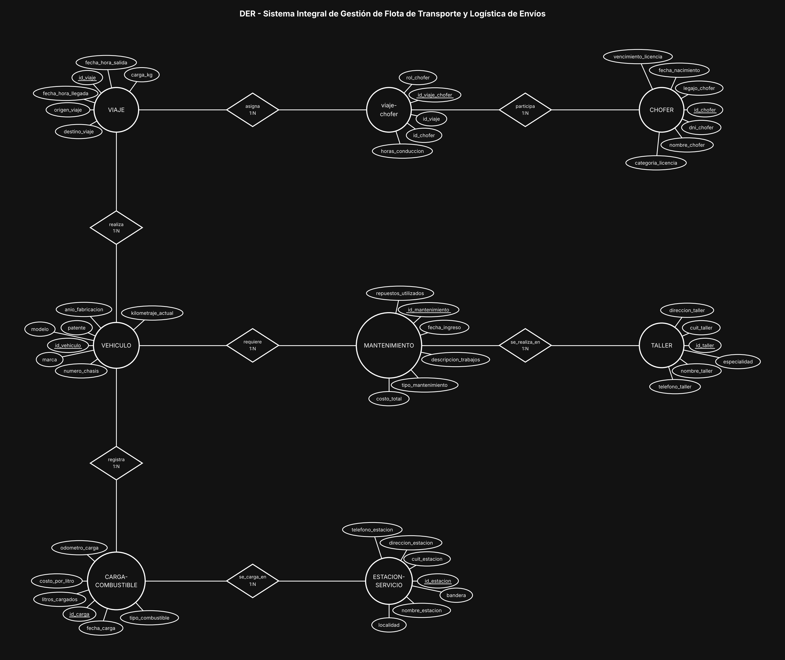
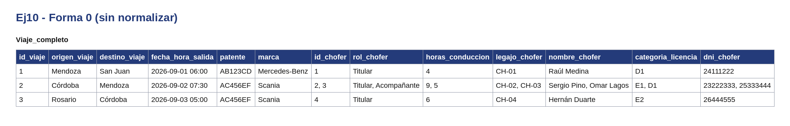
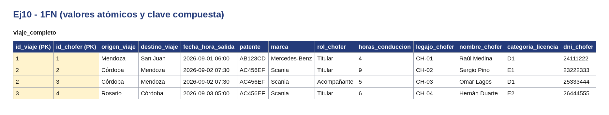
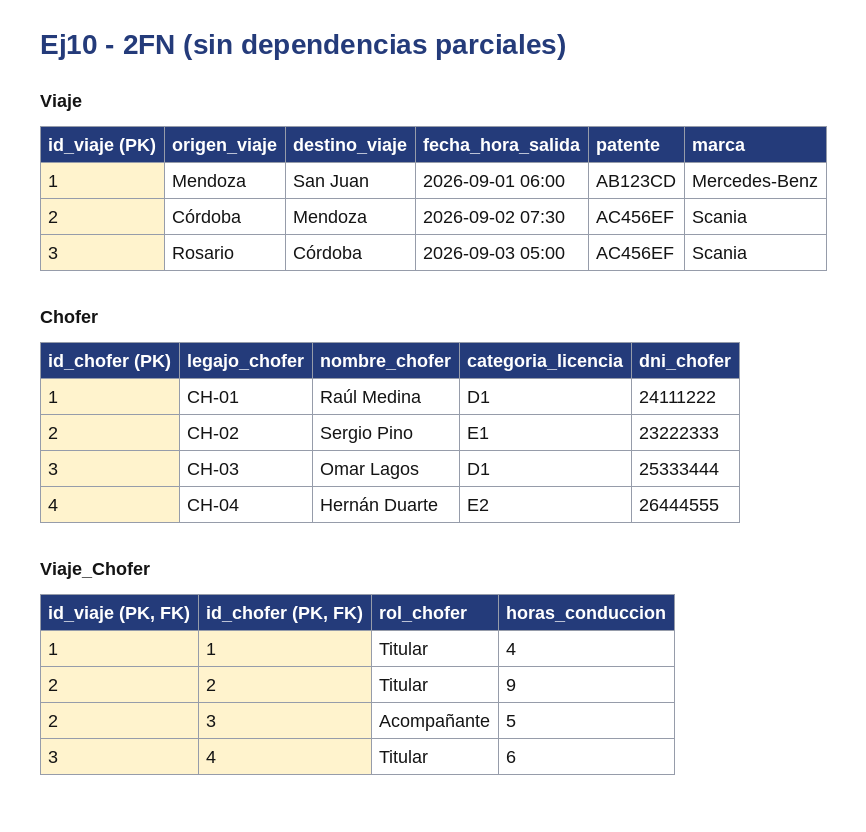
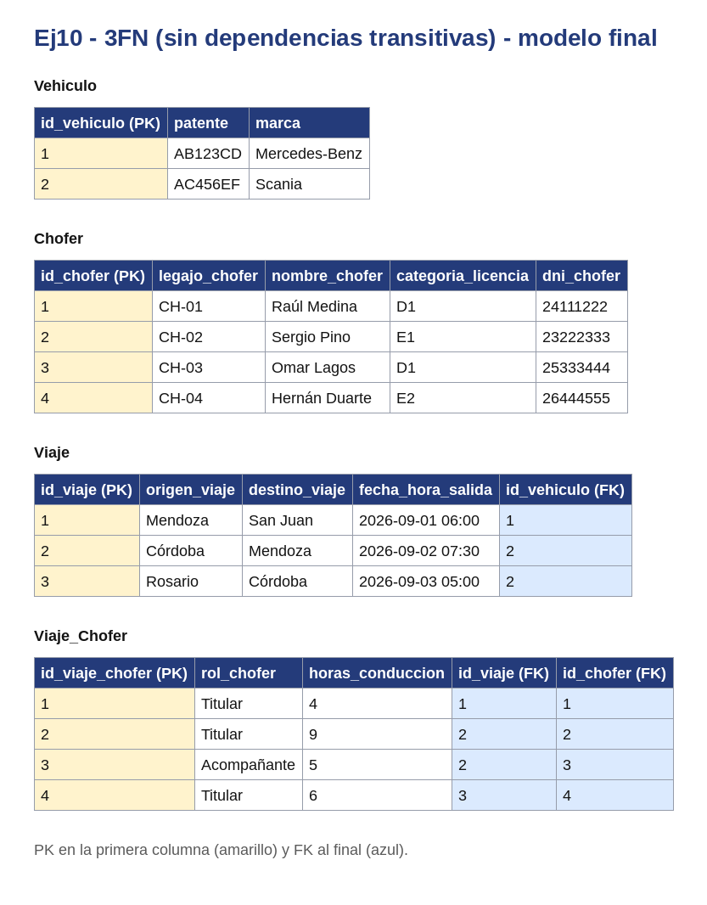

# BaseDeDatos-U1-Ej10-FlotaTransporte

Base de Datos - Unidad 1 - Ejercicio 10

## Consigna

Modelar el sistema integral de una empresa de logística de cargas pesadas: flota de vehículos, choferes con sus licencias, viajes con asignación de personal, mantenimientos en talleres y cargas de combustible en estaciones de servicio.

## Lógica

**VIAJE es entidad, no una relación N:M entre vehículo y chofer.** Tiene identidad y atributos propios (origen, destino, carga, horarios), y existe aunque se quiera reprogramar quién lo maneja. El vehículo se asocia por una relación 1:N (`realiza`): un viaje lleva un solo vehículo, un vehículo hace muchos viajes a lo largo del tiempo.

**Viaje ↔ Chofer: N:M con `viaje-chofer`.** El enunciado pide uno o dos choferes según distancia y normativa de descanso, así que la cardinalidad del lado chofer es (1,2): participación obligatoria mínima de uno y máximo dos. El DER no puede expresar el tope de dos, así que se implementa como restricción (CHECK o trigger que cuente las filas de la intermedia por viaje). El atributo `rol_chofer` (titular / relevo) es del vínculo, no del chofer, porque la misma persona es titular en un viaje y relevo en otro; `horas_conduccion` sirve para controlar la normativa de descanso.

**MANTENIMIENTO como entidad asociativa entre VEHICULO y TALLER.** Resuelve el N:M (un vehículo va a muchos talleres, un taller atiende muchos vehículos) y carga los atributos propios de la intervención: tipo (preventivo/correctivo), fecha de ingreso, trabajos, repuestos y costo. `repuestos_utilizados` quedó como atributo siguiendo el enunciado; si se quisiera control de stock o costo por pieza, habría que normalizarlo con una entidad REPUESTO y una intermedia `mantenimiento-repuesto` con cantidad y precio unitario.

**CARGA-COMBUSTIBLE como entidad de registro entre VEHICULO y ESTACION-SERVICIO.** Cada carga es un hecho con fecha, litros, costo por litro y odómetro. El `odometro_carga` es la clave del modelo: guarda la lectura **en el momento de la carga**, que es un dato histórico y no puede reemplazarse por el `kilometraje_actual` del vehículo (ese es un único valor que se pisa). Con dos cargas consecutivas del mismo vehículo se calcula el consumo real: litros cargados dividido la diferencia de odómetros.

**Nomenclatura y redundancias evitadas (punto 4).** Entidades en singular y mayúscula, intermedias nombradas con las dos entidades de origen, relaciones con verbo. No se puso una relación directa Chofer–Vehículo: qué chofer manejó qué unidad se deduce del viaje, y una relación directa sería redundante y podría contradecir los datos del viaje. Tampoco se duplicó el kilometraje en el viaje: se reconstruye desde las cargas de combustible.

**Restricciones de integridad y participación:**

- Participación total de VIAJE en `viaje-chofer`: ningún viaje puede quedar sin al menos un chofer asignado. El máximo de dos se controla por restricción.
- Un chofer no debería tener dos viajes solapados en el tiempo, ni un vehículo estar en dos viajes a la vez: chequeo de rangos sobre salida y llegada, igual criterio que el de reservas del ejercicio 7.
- `vencimiento_licencia` debería validarse contra la fecha de salida del viaje: no se puede asignar un chofer con licencia vencida, ni con categoría inferior a la que exige el vehículo.
- El odómetro de una carga nueva no puede ser menor al de la última carga registrada de ese mismo vehículo.
- Un vehículo en mantenimiento no debería poder asignarse a un viaje en esas fechas.

**Convención de claves.** Toda entidad lleva como PK un identificador propio `id_<entidad>` (subrayado en el diagrama) y al menos 5 atributos además del id; el código o documento de negocio (`dni`, `codigo_*`, `legajo`, etc.) queda como atributo común con restricción UNIQUE. Las entidades intermedias de las relaciones N:M llevan los tres ids: el propio y las dos FK de las entidades que unen (UNIQUE compuesto sobre ambas FK). Atributos agregados para llegar al mínimo de 5 y que no figuran en la consigna: `tipo_combustible` en CARGA-COMBUSTIBLE.

## Resultado

---

## Normalización

Se normaliza el documento `Viaje` con sus registros de `Viaje_Chofer`. En todas las tablas la PK va en la primera columna y las FK al final. Los datos son de ejemplo.

**Forma 0.** Una sola tabla con todo junto. Hay celdas con listas: cada viaje puede tener varios registros de viaje chofer.

**1FN.** Cada elemento de la lista pasa a su propia fila y la clave queda compuesta: (`id_viaje`, `id_chofer`).

**2FN.** Los datos de viaje dependen solo de `id_viaje` y los de chofer solo de `id_chofer`. Se separan en `Viaje` y `Chofer`; `Viaje_Chofer` queda con la clave compuesta y lo que depende de ambos.

**3FN.** Los datos de `Vehiculo` dependen de su propio identificador y no de la PK de viaje, así que pasan a tablas aparte. En el modelo final cada tabla usa su id propio.

